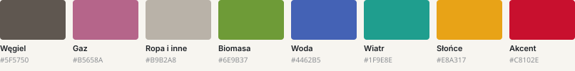

# Jak powstał raport „Węgiel traci grunt”

Materiał towarzyszący wystąpieniu **„Perfekcyjne wizualizacje w Pythonie: raporty bez kompromisów”**.
Opisuje dane, proces i system wizualny — wszystko, czego nie ma w samym raporcie, bo raport ma mówić o danych, a nie o sobie.

## Dane

- Źródło: [owid/energy-data](https://github.com/owid/energy-data) (Our World in Data, CC BY 4.0), opracowane na podstawie Ember oraz Energy Institute Statistical Review of World Energy.
- W repozytorium jest wycinek: kraje UE-27 i agregat UE, lata 1990–2025 (`data/owid_energy_eu.csv`). Odświeżenie: `uv run python scripts/fetch_data.py`.
- Udziały źródeł liczone są z produkcji w TWh. Kategoria „Ropa i inne” łączy ropę, energię jądrową (w Polsce 0) i pozostałe OZE poza biomasą.
- **OZE** — biomasa, energia wodna, wiatrowa i słoneczna. **Emisyjność** — emisja CO₂ (ekw.) na kWh wyprodukowanej energii elektrycznej. Średnia UE dotyczy agregatu UE-27.

Warstwa danych (`raport/data.py`) zwraca `ReportData` — zwykłe listy i słowniki. Wykresy i szablon nie wiedzą, skąd pochodzą liczby, więc źródło (np. API PSE albo GUS BDL) można podmienić, nie dotykając wizualizacji.

## Proces

```
uv run python -m raport.build        # raport PDF
uv run python -m prezentacja.build   # prezentacja HTML (buduje też raport)
```

1. **Polars** — wczytanie CSV, agregacja do 7 kategorii źródeł, wskaźniki (`build/data.json`).
2. **pyDreamplet** — wykresy SVG rysowane w docelowym rozmiarze strony (1 jednostka SVG = 1 pt).
   Etykiety są mierzone prawdziwymi metrykami fontu (HarfBuzz), zanim wykres zostanie narysowany.
3. **Typst** — skład stron; każda liczba w tekście pochodzi z `build/data.json`, kolory i fonty z `build/theme.json`.

Ten sam kod wykresów zasila prezentację: `prezentacja/build.py` rysuje warianty w kadrach slajdów,
wstawia SVG inline, a animacje czytają klasy i atrybuty `data-*`, które pyDreamplet zapisał w SVG
(np. `data-dy` — o ile algorytm kolizji przesunął etykietę).

## System wizualny

Jedno źródło prawdy: [`raport/theme.py`](../raport/theme.py). Wykresy (Python), skład (Typst) i slajdy (CSS) czytają te same tokeny.



- **Kolor ma znaczenie.** Węgiel — największa kategoria — jest szarym tłem, na którym widać zmiany; pozostałe źródła mają własne kolory. Szary nie oznacza oceny. Kolejność kategorii jest stała, kolor idzie za kategorią.
- **Jeden akcent.** Czerwień oznacza wyłącznie Polskę (lub jedno wyróżnienie na wykres).
- **Typografia.** Source Serif 4 — nagłówki; Inter — tekst, liczby i wykresy; IBM Plex Mono — kod. Skala (pt): 6,5 · 7,5 · 9,5 · 12 · 20 · 34.
- **Paleta zweryfikowana pod kątem daltonizmu** (separacja sąsiednich kolorów). Węgiel jest wyjątkiem od progu nasycenia, dlatego zawsze ma etykietę.

## Zasady — i kod, który ich pilnuje

| # | Zasada | Gdzie w kodzie |
|---|---|---|
| 1 | Tytuł podaje informację, nie ocenę. | `chart(title, subtitle, source)` w `template/components.typ` |
| 2 | Etykiety przy danych zamiast legendy. | `place_labels_1d()` w `raport/charts/mix.py` |
| 3 | Kolor ma znaczenie i stałą kolejność. | `SOURCE_ORDER`, `raport/theme.py` |
| 4 | Szarość dla tła, akcent tylko do wyróżnienia. | `ink.accent`, `raport/theme.py` |
| 5 | Wykres w skali strony: 1 jednostka = 1 pt. | `Canvas(width, height)` w `raport/charts/base.py` |
| 6 | Mierz tekst przed rysowaniem. | `text_width()` w `raport/charts/base.py` |
| 7 | Cienkie linie zamiast ramek i obrysów. | `stroke=T.ink.paper` w `raport/charts/mix.py` |
| 8 | Wspólna skala w porównaniach. | `growth_multiples()` w `raport/charts/multiples.py` |
| 9 | Każda liczba w tekście pochodzi z danych. | `#num(k.…)` w `template/raport.typ`, `build/data.json` |
| 10 | Jedno polecenie od danych do PDF. | `python -m raport.build` |

## Fonty

Statyczne instancje fontów zmiennych z [Google Fonts](https://github.com/google/fonts) (licencja OFL, pliki licencji w `fonts/`).
Prezentacja osadza ich podzbiór (łacina + polskie znaki), więc działa offline.
